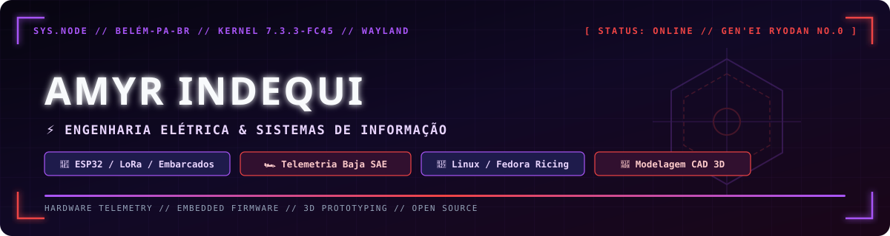

<div align="center">



<br/>

[](https://github.com/amyrindequi-design/fedora-gnome-larper-rice)
[-a855f7?style=for-the-badge&logo=gnome&logoColor=white)](https://github.com/amyrindequi-design/fedora-gnome-larper-rice)
[](#)
[](#)
[](mailto:amyrindequi@gmail.com)

</div>

---

## ⚡ `whoami` // Sobre Mim

```yaml
nome: "Amyr de Oliveira Indequi"
localizacao: "Belém - PA, Brasil"
formacao:
  - curso: "Engenharia Elétrica (8º Semestre)"
    instituicao: "Estácio"
  - curso: "Sistemas de Informação (5º Semestre)"
    instituicao: "UFRA (Universidade Federal Rural da Amazônia)"
atuacao_atual:
  - "Participante de Eletrônica Embarcada & Telemetria — Projeto Baja SAE"
  - "Colaborador na Área de Eletrônica & Educação Tecnológica — Projeto CISEB (Pará)"
foco_tecnico:
  - "Sistemas Embarcados (ESP32 / ESP32-S3, LoRa32 V3, Sensores Hall, SPI/I2C)"
  - "Telemetria Veicular Off-Road sem dependência de internet"
  - "Modelagem e Prototipagem 3D (FreeCAD, SolidWorks, AutoCAD, Blender)"
  - "Linux, Automação em Python/Bash e Customização de Ambientes (Ricing)"
```

---

## 🛠️ Tech Stack & Ferramentas

### 🔌 Eletrônica Embarcada, Hardware & CAD 3D
<p>
  
  
  
  
  
  
</p>

### 💻 Linguagens, Linux & Dev Tools
<p>
  
  
  
  
  
  
  
</p>

---

## 🚀 Projetos em Destaque

| Projeto | Descrição | Tecnologias |
| :--- | :--- | :--- |
| 🕷️ **[fedora-gnome-larper-rice](https://github.com/amyrindequi-design/fedora-gnome-larper-rice)** | Setup completo de customização (**Linux Larper / Rice**) para Fedora GNOME Wayland (Chrollo Edition): Cubo 3D, Blur my Shell, Burn My Windows, Fastfetch customizado, Starship, painel `tmux` 4-em-1 (`larper`) e instalador automático. | `Linux` `GNOME` `Bash` `Python` `Tmux` `Fastfetch` |
| 🏎️ **Telemetria & Eletrônica Baja SAE** | Desenvolvimento elétrico de veículo off-road universitário: medição de RPM/velocidade com sensor Hall A3144, telemetria de longa distância via **ESP32-S3 + LoRa32 V3** sem internet, display OLED SSD1306 (SPI) e modelagem 3D da gaiola. | `C++` `ESP32-S3` `LoRa` `SPI` `FreeCAD` `Python` |
| 🤖 **Projeto CISEB — Eletrônica & Robótica** | Colaboração técnica em projetos de eletrônica embarcada, manutenção de bancadas e ensino prático de robótica e tecnologia para jovens no Pará. | `Eletrônica` `Arduino` `ESP32` `Robótica` |
| ⚖️ **[normas-consumidor](https://github.com/amyrindequi-design/normas-consumidor)** | Base estruturada em Markdown do Código de Defesa do Consumidor (CDC) e Lei 9.099 para consulta rápida e integração em soluções de Hackathon. | `Markdown` `Automação` `Hackathon` |

---

## 🖥️ Meu Ambiente Linux (`fastfetch`)

```text
                                           ╭─── 󰣛 amyr@fedora ─── [SKILL HUNTER // SYS.HUD] ───╮
          ╲         ▄█▄         ╱          │ 󰣛 Distro   ❯ Fedora Linux Workstation Edition
       ╲   ╲        ███        ╱   ╱       │ 󰌽 Kernel   ❯ Linux 7.3.3 x86_64
        ╲   ╲    ▄▄█████▄▄    ╱   ╱        │ 󱂬 WM/Comp  ❯ Mutter (Wayland) + 3D Desktop Cube
         ╲   ╲ ▄███████████▄ ╱   ╱         │ 󰆍 Shell    ❯ bash + Starship Prompt
     ╲    ╲   ████▀▀   ▀▀████   ╱    ╱     │  Term     ❯ Ptyxis (Blurred Glass) + Tmux Deck
      ╲    ╲ ███▀   ▄█▄   ▀███ ╱    ╱      ├────────────── [ TELEMETRY // HARDWARE ] ──────────────┤
       ╲    ████   ██▀██   ████    ╱       │ 󰻠 CPU      ❯ 13th Gen Intel Core i3-1305U
   ─────╲──█████   ██▄██   █████──╱─────   │ 󰢮 GPU      ❯ Intel UHD Graphics
       ╱    ████    ▀█▀    ████    ╲       │ 󰍛 Memory   ❯ [ ████░░░░░░░░░░ ] 3.1 GiB / 11.3 GiB
      ╱    ╱ ███▄   ███   ▄███ ╲    ╲      │ 󰋊 Disk     ❯ [ █░░░░░░░░░░░░░ ] btrfs
     ╱    ╱   ████▄▄███▄▄████   ╲    ╲     ╰───────────────────────────────────────────────────────╯
         ╱   ╱ ▀███████████▀ ╲   ╲            👉 Quer deixar seu Linux igual?
        ╱   ╱    ▀▀█████▀▀    ╲   ╲              Veja: github.com/amyrindequi-design/fedora-gnome-larper-rice
       ╱   ╱       █████       ╲   ╲
          ╱         ▀█▀         ╲
         ── GEN'EI RYODAN // NO.0 ──
```
